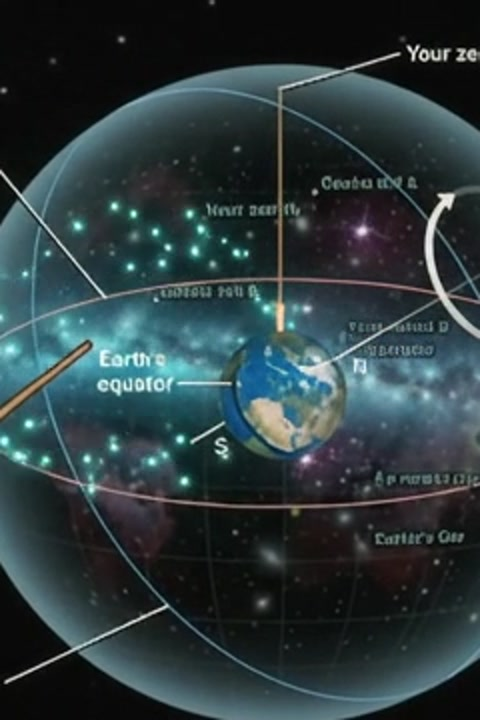
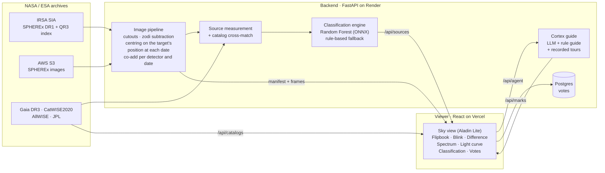

<div align="center">

# AstroCortex

**See how the sky changes in NASA's SPHEREx images, field by field.**

NASA Space Apps Challenge 2026 · Lima · Challenge *Planet X and SPHEREx*

[](https://astrocortex.vercel.app/)
[](https://spherex-api-u38l.onrender.com/docs)

[](https://github.com/Miguel-Ghost/AstroCortex/actions/workflows/ci.yml)
[](https://github.com/Miguel-Ghost/AstroCortex/actions/workflows/frontend.yml)
[](https://github.com/Miguel-Ghost/AstroCortex/actions/workflows/motor.yml)
[](https://github.com/Miguel-Ghost/AstroCortex/actions/workflows/keepalive.yml)


</div>

AstroCortex is a public web tool. Enter a sky position (or pick a test target) and it shows the SPHEREx images of that
field as an aligned flipbook over time, in each of SPHEREx's six infrared detectors. It measures the sources in the field,
cross-matches them with Gaia DR3 and CatWISE2020, classifies them, and puts first the ones that need a human look.
A guide agent, Cortex, can walk through any field step by step.

> **Note:** the interface says *candidate*, never *discovery*. A source in "Needs review" is a source someone should look at.

---

## Try it

Each link opens the viewer in a ready-made view. The free API may take up to a minute to wake up; the five test fields
also load without it.

| Target | What to look for | Open |
|---|---|---|
| **WISE 0855−0714** (coldest known brown dwarf) | A faint dot moving ~1.3 px west between the first and last date, in detector D5 | [Flipbook](https://astrocortex.vercel.app/?target=wise0855&det=5&mode=flip) · [Blink](https://astrocortex.vercel.app/?target=wise0855&det=5&mode=blink&a=0&b=2) · [6 detectors](https://astrocortex.vercel.app/?target=wise0855&det=5&grid=1) |
| **Barnard's Star** (fastest-moving star) | Moves ~1.6 px north between dates in D2 | [Flipbook](https://astrocortex.vercel.app/?target=barnard&det=2&mode=flip) · [Blink](https://astrocortex.vercel.app/?target=barnard&det=2&mode=blink&a=0&b=2) |
| **Epsilon Indi B** (nearby brown dwarf pair) | ~1 px of motion over four dates in D5 | [Flipbook](https://astrocortex.vercel.app/?target=epsindib&det=5&mode=flip) · [Difference](https://astrocortex.vercel.app/?target=epsindib&det=5&mode=diff&a=0&b=3) |
| **RW Aurigae** (young variable star) | Does not move; brightness changes between dates in D3 | [Flipbook](https://astrocortex.vercel.app/?target=rwaur&det=3&mode=flip) |
| **R Draconis** (Mira variable) | Does not move; very bright, saturated core shown as no data | [Flipbook](https://astrocortex.vercel.app/?target=rdra&det=3&mode=flip) |

Keyboard and controls in the viewer: play/pause, previous/next date, Blink, Difference, Sum, D1–D6, *6 panels*, Flags,
Gaia and WISE layers, and **Share** to copy the current view as a link. `/embed` shows only the flipbook for other sites.

<table>
<tr>
<td align="center"><br><b>Your sky</b><br>search by coordinates or name</td>
<td align="center"><br><b>Explore</b><br>flipbook, blink, difference, detectors</td>
<td align="center"><br><b>Cortex</b><br>guided tours of the field</td>
</tr>
</table>

---

## How it works



<details>
<summary><b>Image pipeline</b>: from the archive to an aligned flipbook</summary>

1. **Index.** One query per field to IRSA's SIA service, always over `spherex_dr1` and `spherex_qr3`.
2. **Pixels.** Only a small cutout of each image is read from the SPHEREx copy on AWS S3 (31 × 31 px ≈ 1.5 MB instead of a 66 MB file). IRSA cutouts are the fallback.
3. **Clean.** Zodiacal light is subtracted; quality flags are read from the file header and kept as an overlay.
4. **Centre.** Each field is centred on where the target is at the date of each exposure (Gaia DR3 or CatWISE2020 proper motions). The 2010 coordinate of WISE 0855 given in the challenge is ~130″ away from where the object is now; the API still opens its field.
5. **Co-add.** Exposures are grouped into dates and combined per detector (3 to 45 exposures per frame).
6. **Publish.** The five test targets are precomputed: 94 frames, 3–4 dates each, 6.2″/px. Any other position is built live in about a minute when SPHEREx data cover it.

</details>

<details>
<summary><b>Classification engine</b>: Random Forest served as ONNX</summary>

- Sources are measured on the co-adds and cross-matched with Gaia DR3 and CatWISE2020.
- The served model (`Motor/artifacts/models/actual`) separates **cold brown dwarfs (T/Y)** from stars, using CatWISE2020 colour and motion plus SPHEREx detector colours and a methane index. Galaxy and asteroid labels come from rules (extended shape, JPL match).
- Trained on 11 850 labelled objects; Random Forest, XGBoost and a neural network compared with cross-validation on separate sky regions.
- External test (151 objects in sky cells never used for training): balanced accuracy 0.958, cold-dwarf precision 0.949, recall 0.949.
- Caveats, stated in `Motor/README.md`: cold dwarfs are 42 % of the training subset but far rarer on the sky, so real precision will be lower; most of the signal comes from the WISE W1−W2 colour.
- Every source gets a review status: **Known** (catalog type agrees), **Classified** (no previous type), or **Needs review**, with reasons such as *Moves, no catalog motion* or *High methane index, not a known dwarf*.
- The catalog type is never an input to the model. With `MODEL_PATH=rule` the backend goes back to the rule-based v0.

</details>

<details>
<summary><b>Cortex, the guide agent</b></summary>

- Answers questions about the open field and builds step-by-step tours whose actions move the viewer (select a source, blink two dates, show the six detectors, ask for a vote).
- States only what the API returns. An LLM writes the answer; the steps come from a rule-based guide. If the model is slow or unavailable, the rule guide answers, and if the API is down, recorded tours of the five targets are used.
- Any manual action pauses the tour, so the user keeps control.

</details>

<details>
<summary><b>Checks on real data</b></summary>

| Check | Result |
|---|---|
| WISE 0855 motion, D5 | ~1.3 px west across three dates (x 14.3 → 15.0 → 15.6) |
| Barnard's Star motion, D2 | ~1.6 px north across three dates |
| WISE 0855 spectrum | ≈ 0 below 3.5 µm; 0.37–0.46 mJy at 4–5 µm, consistent with its WISE W2 flux (≈ 0.48 mJy) |
| Barnard's Star light curve | Flat, 0.97–1.01 |
| Spectra and light curves | Built from 1 927 single SPHEREx exposures |

Light curves of Epsilon Indi B and RW Aurigae carry a warning: their detectors differ between some dates, so changes there are not presented as confirmed variability.

</details>

<details>
<summary><b>API</b>: https://spherex-api-u38l.onrender.com/docs</summary>

| Endpoint | Returns |
|---|---|
| `GET /api/field?ra=&dec=&fov_arcmin=` | Field manifest: dates, detectors, frames, flags, expected position |
| `GET /api/sources?field_id=` | Sources with class, review status, reasons and summary |
| `GET /api/catalogs?field_id=` | Gaia and WISE layers at the field's date |
| `POST /api/agent` | Cortex answer and tour steps |
| `POST /api/marks` · `GET /api/marks` | Votes (Real / Artifact / Not sure) |
| `GET /health` | Status and deployed commit |

Errors always come as `{"error": {"code": "...", "message": "..."}}`.

</details>

<details>
<summary><b>Run it locally</b></summary>

```bash
# Backend
cd Backend
pip install -r requirements-dev.txt
uvicorn app.main:app --reload          # http://localhost:8000/docs

# Frontend
cd Frontend
npm install
npm run dev                            # http://localhost:5173
```

More detail in [`Backend/README.md`](Backend/README.md), [`Frontend/README.md`](Frontend/README.md) and [`Motor/README.md`](Motor/README.md).

</details>

---

## Repository

| Folder | Content |
|---|---|
| [`Backend/`](Backend) | FastAPI API, SPHEREx image pipeline, classifier serving, static fields, tests |
| [`Frontend/`](Frontend) | React + Vite viewer: sky view, flipbook, classification panel, Cortex, tutorials |
| [`Motor/`](Motor) | Classification engine: data, cross-match, EDA, model comparison, ONNX export, reports (DVC pipeline) |
| `render.yaml` | Render Blueprint (API + Postgres) |
| `.github/workflows/` | Tests, Render and Vercel deploys, keep-alive |

**Stack:** Python (FastAPI, Astropy, NumPy, fsspec, scikit-learn, XGBoost, ONNX Runtime) · React, Vite, Zustand, Aladin Lite · Render, PostgreSQL, Vercel, GitHub Actions · Gemini Flash-Lite for the guide.

## Data and credits

- **SPHEREx** data from NASA/IPAC Infrared Science Archive (IRSA) and its AWS open-data copy.
- **Gaia DR3** (ESA), **CatWISE2020**, **AllWISE** (NASA/IPAC), **JPL Small-Body Identification API**.
- Labels from catalog cross-matches, including the UltracoolSheet compilation of brown dwarfs.
- Sky view with **Aladin Lite** (CDS, Strasbourg); interface inspired by WiseView.

## Team

| | Role |
|---|---|
| **Brian Jara** | Backend, image pipeline, API contracts, model serving, deployment |
| **Miguel** | Data preprocessing and model training |
| **Paolo** | Catalog cross-match, EDA, features and variable importance |
| **Alessandro** | Frontend and viewer design |

AI assistants were used to help write code and documentation. Results were checked against the data.
